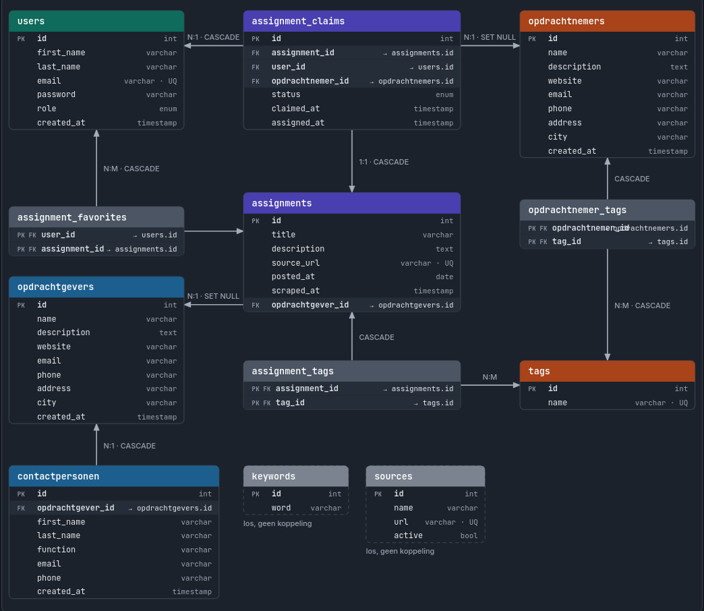

# Campus Database Schema

Alle 12 tabellen met hun foreign keys. Pijlen wijzen van de tabel met de foreign key naar de tabel waar hij naar verwijst.

Users claimen opdrachten via assignment_claims; een claim kan aan een opdrachtnemer gekoppeld worden. Een opdracht hoort optioneel bij een opdrachtgever (een bedrijf met contactgegevens), en een opdrachtgever heeft één of meer contactpersonen. Tags koppelen opdrachten en opdrachtnemers aan elkaar (N:M). Users kunnen opdrachten favoriet maken via assignment_favorites.

## Alle foreign keys

| Kolom | Verwijst naar | Relatie | Bij verwijderen |
| --- | --- | --- | --- |
| `assignment_claims.assignment_id` | `assignments.id` | 1:1 (unique) | CASCADE |
| `assignment_claims.user_id` | `users.id` | N:1 | CASCADE |
| `assignment_claims.opdrachtnemer_id` | `opdrachtnemers.id` | N:1, optioneel | SET NULL |
| `assignments.opdrachtgever_id` | `opdrachtgevers.id` | N:1, optioneel | SET NULL |
| `contactpersonen.opdrachtgever_id` | `opdrachtgevers.id` | N:1 | CASCADE |
| `assignment_favorites.user_id` | `users.id` | N:M | CASCADE |
| `assignment_favorites.assignment_id` | `assignments.id` | N:M | CASCADE |
| `assignment_tags.assignment_id` | `assignments.id` | N:M | CASCADE |
| `assignment_tags.tag_id` | `tags.id` | N:M | CASCADE |
| `opdrachtnemer_tags.opdrachtnemer_id` | `opdrachtnemers.id` | N:M | CASCADE |
| `opdrachtnemer_tags.tag_id` | `tags.id` | N:M | CASCADE |

## Goed om te weten

- Tabel `companies` is hernoemd naar `opdrachtnemers` en `company_tags` naar `opdrachtnemer_tags`. Het model voor `assignment_claims` heet `AssignmentClaim`.
- schema.png moet nog opnieuw geëxporteerd worden met de nieuwe tabellen.
- PK = primary key. FK = foreign key (gemarkeerde rij). UQ = unieke waarde.
- De pivot-tabellen hebben geen eigen id: de combinatie van beide kolommen is de primary key, dus dezelfde koppeling kan niet dubbel.
- keywords en sources hebben nu geen koppeling met andere tabellen.
- Verwijder je een user, dan verdwijnen ook zijn claims (assignment_claims.user_id is CASCADE). De opdrachten blijven bestaan.
- assignment_favorites en de cascade op user_id zijn nieuw: die migraties moeten nog met php artisan migrate op de echte database gedraaid worden.