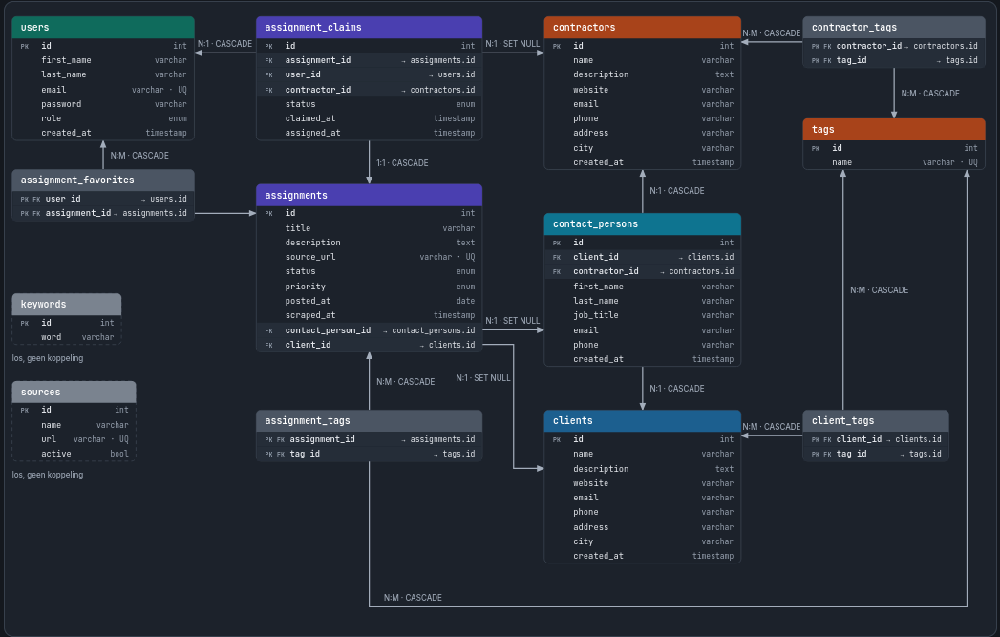

# Campus Database Schema

Alle 13 tabellen met hun foreign keys. Pijlen wijzen van de tabel met de foreign key naar de tabel waar hij naar verwijst.

Users claimen opdrachten via assignment_claims; een claim kan aan een contractor gekoppeld worden. Een opdracht hoort optioneel bij een client (een bedrijf met contactgegevens) en kan één contactpersoon hebben. Een contactpersoon hoort bij precies één client óf één contractor. Tags koppelen opdrachten, clients en contractors aan elkaar (N:M). Users kunnen opdrachten favoriet maken via assignment_favorites.

Elke opdracht heeft een `status` (`new`, `in_review`, `accepted`, `rejected`, `assigned`) en een `priority` (`high`, `medium`, `low`).

## Alle foreign keys

| Kolom | Verwijst naar | Relatie | Bij verwijderen |
| --- | --- | --- | --- |
| `assignment_claims.assignment_id` | `assignments.id` | 1:1 (unique) | CASCADE |
| `assignment_claims.user_id` | `users.id` | N:1 | CASCADE |
| `assignment_claims.contractor_id` | `contractors.id` | N:1, optioneel | SET NULL |
| `assignments.client_id` | `clients.id` | N:1, optioneel | SET NULL |
| `assignments.contact_person_id` | `contact_persons.id` | N:1, optioneel | SET NULL |
| `contact_persons.client_id` | `clients.id` | N:1, optioneel (1 van 2) | CASCADE |
| `contact_persons.contractor_id` | `contractors.id` | N:1, optioneel (1 van 2) | CASCADE |
| `client_tags.client_id` | `clients.id` | N:M | CASCADE |
| `client_tags.tag_id` | `tags.id` | N:M | CASCADE |
| `assignment_favorites.user_id` | `users.id` | N:M | CASCADE |
| `assignment_favorites.assignment_id` | `assignments.id` | N:M | CASCADE |
| `assignment_tags.assignment_id` | `assignments.id` | N:M | CASCADE |
| `assignment_tags.tag_id` | `tags.id` | N:M | CASCADE |
| `contractor_tags.contractor_id` | `contractors.id` | N:M | CASCADE |
| `contractor_tags.tag_id` | `tags.id` | N:M | CASCADE |

## Goed om te weten

- Alle tabel-, kolom- en enumnamen zijn Engels. `companies` heet nu `contractors` en `company_tags` heet `contractor_tags`. Nieuw zijn `clients`, `client_tags` en `contact_persons`. Het model voor `assignment_claims` heet `AssignmentClaim`.
- `contact_persons.client_id` en `contact_persons.contractor_id` zijn allebei nullable, maar precies één moet gevuld zijn. MySQL staat geen CHECK toe op kolommen met een CASCADE foreign key, dus het model `ContactPerson` controleert dit bij het opslaan.
- schema.png moet nog opnieuw geëxporteerd worden met de nieuwe tabellen.
- PK = primary key. FK = foreign key (gemarkeerde rij). UQ = unieke waarde.
- De pivot-tabellen hebben geen eigen id: de combinatie van beide kolommen is de primary key, dus dezelfde koppeling kan niet dubbel.
- keywords en sources hebben nu geen koppeling met andere tabellen.
- Verwijder je een user, dan verdwijnen ook zijn claims (assignment_claims.user_id is CASCADE). De opdrachten blijven bestaan.
- assignment_favorites en de cascade op user_id zijn nieuw: die database moet opnieuw opgebouwd worden met php artisan migrate:fresh --seed (de migrations zijn aangepast, niet uitgebreid).